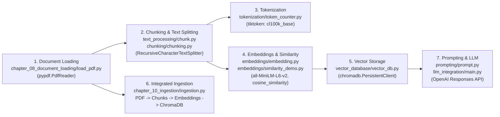

# RAG Engineering — Structural & Flow Information

This document describes the directory structure, file-level functionality, and end-to-end RAG data flow of the `RAG ENG` repository.

## 1. Directory Structure

```text
RAG ENG/
├── .gitignore                          # Excludes caches, .venv, .env, vector_store/, and OS files
├── README.md                           # Project layout, venv setup, and run commands
├── requirements.txt                    # Python package dependencies (chromadb, pypdf, openai, etc.)
├── .vscode/                            # VS Code workspace settings
│   └── settings.json                   # Suppresses Git ignore limit warnings
├── text_processing/                    # Basic word-based text chunking
│   └── chunk.py                        # Splits text by words with fixed chunk size and overlap
├── chunking/                           # Recursive character splitting with LangChain
│   └── chunking.py                     # Splits multi-line text via RecursiveCharacterTextSplitter
├── tokenization/                       # Tokenization and token counting
│   └── token_counter.py                # Encodes text with tiktoken (cl100k_base) and counts tokens
├── embeddings/                         # Dense vectors and semantic similarity demos
│   ├── embedding.py                    # Encodes text into a 384-D vector using all-MiniLM-L6-v2
│   ├── embedding_notes.txt             # Explains embedding.py and 384-D semantic vector output
│   └── similarity_demo.py              # Compares sentence embeddings using cosine_similarity
├── prompting/                          # Prompt template construction
│   └── prompt.py                       # Formats an AI tutor prompt via create_prompt(topic, level)
├── vector_database/                    # Local vector database persistence
│   └── vector_db.py                    # Upserts sample documents into persistent ChromaDB
├── chapter_08_document_loading/        # PDF text extraction
│   ├── load_pdf.py                     # Extracts and prints text from fastapi_tutorial.pdf
│   └── documents/                      # Sample input documents for chapter 08
│       └── fastapi_tutorial.pdf        # Sample FastAPI PDF read by load_pdf.py
├── llm_integration/                    # OpenAI Responses API integration
│   ├── .env                            # Stores OPENAI_API_KEY for local runs
│   └── main.py                         # Calls OpenAI Responses API (gpt-5.4) and prints output
└── chapter_10_ingestion/               # End-to-end PDF-to-ChromaDB ingestion pipeline
    ├── ingestion.py                    # Loads PDF, chunks text, embeds, and upserts into ChromaDB
    └── documents/                      # Sample input documents for chapter 10
        └── fastapi_tutorial.pdf        # Sample FastAPI PDF ingested by ingestion.py
```

---

## 2. Conceptual RAG Pipeline Flow

The repository progresses from standalone building blocks to an integrated ingestion pipeline (`chapter_10_ingestion/ingestion.py`):



---

## 3. Folder & File Functionality

### Root Files
| File | Purpose | Key Details |
| --- | --- | --- |
| `.gitignore` | Git ignore rules | Ignores `__pycache__/`, `*.py[cod]`, `.venv/`, `venv/`, `.env`, `vector_store/`, `**/vector_store/`, `.DS_Store`, `Thumbs.db`. |
| `README.md` | Project documentation | Summarizes the project layout, Python 3.10+ virtual environment setup, `pip install -r requirements.txt`, and example run commands. |
| `requirements.txt` | Python dependencies | Lists `chromadb`, `langchain-text-splitters`, `openai`, `pypdf`, `python-dotenv`, `scikit-learn`, `sentence-transformers`, and `tiktoken`. |

### `.vscode/` — Workspace Configuration
| File | Purpose | Key Details |
| --- | --- | --- |
| `.vscode/settings.json` | VS Code settings | Sets `"git.ignoreLimitWarning": true`. |

### `text_processing/` — Basic Word-Based Chunking
| File | Purpose | Key Details |
| --- | --- | --- |
| `text_processing/chunk.py` | Sliding-window word splitter | Splits `"Python is useful for backend and AI development"` on whitespace using `chunk_size = 5`, `overlap = 2`, `step = chunk_size - overlap` (`3`), and prints each chunk. |

### `chunking/` — Recursive Character Splitting
| File | Purpose | Key Details |
| --- | --- | --- |
| `chunking/chunking.py` | LangChain text splitter demo | Uses `RecursiveCharacterTextSplitter(chunk_size=50, chunk_overlap=10)` on a sample FastAPI/Pydantic multi-line string and prints numbered chunks. |

### `tokenization/` — Token Counting
| File | Purpose | Key Details |
| --- | --- | --- |
| `tokenization/token_counter.py` | Tiktoken encoding & count | Loads `tiktoken.get_encoding("cl100k_base")`, encodes `"I am learning RAG engineering with Python."`, and prints text, token IDs, and `len(tokens)`. |

### `embeddings/` — Vector Embeddings & Cosine Similarity
| File | Purpose | Key Details |
| --- | --- | --- |
| `embeddings/embedding.py` | Single-sentence embedding | Loads `SentenceTransformer("all-MiniLM-L6-v2")`, encodes `"I love Python programming"`, and prints the vector and its dimension count (`384`). |
| `embeddings/similarity_demo.py` | Semantic similarity comparison | Encodes 3 sample sentences with `all-MiniLM-L6-v2` and computes `cosine_similarity([embeddings[0]], embeddings[1:])` using `scikit-learn`. |
| `embeddings/embedding_notes.txt` | Conceptual notes | Documents `embedding.py`, explaining dense floating-point embeddings and the 384-dimensional semantic vector output. |

### `prompting/` — Prompt Template Formatting
| File | Purpose | Key Details |
| --- | --- | --- |
| `prompting/prompt.py` | Prompt builder function | Defines `create_prompt(topic, level)` using `str.format` on an AI programming tutor template, calls it with `("Vector Database", "Beginner")`, and prints the prompt. |

### `vector_database/` — Local Vector Database Persistence
| File | Purpose | Key Details |
| --- | --- | --- |
| `vector_database/vector_db.py` | ChromaDB persistence demo | Opens `chromadb.PersistentClient` at `vector_database/vector_store`, gets or creates collection `"rag_documents"`, and upserts two sample sentences (`ids=["1", "2"]`). |

### `chapter_08_document_loading/` — PDF Text Extraction
| File | Purpose | Key Details |
| --- | --- | --- |
| `chapter_08_document_loading/load_pdf.py` | PDF reader script | Defines `main()`, reads `documents/fastapi_tutorial.pdf` via `pypdf.PdfReader`, joins non-empty extracted page text, raises `ValueError` if empty, and prints the text. |
| `chapter_08_document_loading/documents/fastapi_tutorial.pdf` | Sample source PDF | Input document read by `load_pdf.py`. |

### `llm_integration/` — OpenAI LLM Integration
| File | Purpose | Key Details |
| --- | --- | --- |
| `llm_integration/.env` | Environment variables | Defines `OPENAI_API_KEY` (ignored by Git). |
| `llm_integration/main.py` | OpenAI Responses API client | Defines `main()`, loads `llm_integration/.env` via `load_dotenv`, checks `OPENAI_API_KEY` (raises `RuntimeError` if missing), calls `client.responses.create(model="gpt-5.4", input="Explain Python in simple language.")`, and prints `response.output_text`. |

### `chapter_10_ingestion/` — End-to-End Ingestion Pipeline
| File | Purpose | Key Details |
| --- | --- | --- |
| `chapter_10_ingestion/ingestion.py` | Full ingestion pipeline | 1. Resolves `PDF_PATH` (`documents/fastapi_tutorial.pdf`) and `DB_PATH` (`vector_store`).<br>2. Loads `SentenceTransformer("all-MiniLM-L6-v2")` and `RecursiveCharacterTextSplitter(chunk_size=500, chunk_overlap=50)`.<br>3. Extracts text page-by-page with `PdfReader`, splits each page into chunks, and builds metadata (`source`, `page`, `chunk`).<br>4. Encodes chunks with `normalize_embeddings=True`.<br>5. Upserts IDs (`<stem>-page-<page>-chunk-<chunk>`), documents, embeddings, and metadata into ChromaDB collection `"rag_documents"` (`hnsw:space="cosine"`), printing chunk and vector counts. |
| `chapter_10_ingestion/documents/fastapi_tutorial.pdf` | Sample source PDF | Input document ingested into `chapter_10_ingestion/vector_store`. |
